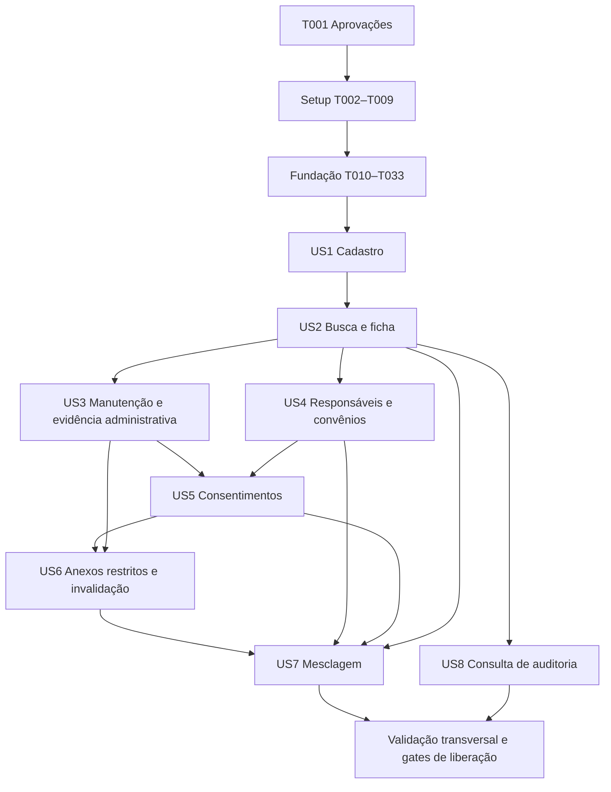

# Tasks: Cadastro e Gestão de Pacientes

**Input**: documentos em `specs/001-gestao-pacientes/`: [spec](spec.md), [plano](plan.md), [pesquisa](research.md), [modelo](data-model.md), [contratos](contracts/application.md) e [quickstart](quickstart.md).

**Branch atual**: `dev`; feature resolvida: `001-gestao-pacientes`. **Data**: 2026-10-24.

**Revisão do backlog**: regenerado a partir do replanejamento posterior às três respostas de Clarifications 2026-10-24. Substitui o backlog anterior referido nos avisos históricos do plano/quickstart; mantém IDs e todas as caixas abertas. Base desta revisão: spec SHA-256 `8A7E2BFE0E28A96CAF5DB5CF105CE7F8EF5A2BE2AC510D61DA6DC579C8581279` e plano SHA-256 `76A24F6FE9BCDDF2045EF20585CACA05882F465F8B99F31BD68751C56508DDA1`.

**Status**: backlog de implementação para revisão; nenhuma tarefa foi executada. Aprovações de produto, técnica e carga ainda não foram registradas. T001 é bloqueio real antes de qualquer código ou teste; gerar este documento não aprova os artefatos.

**Tests**: obrigatórios pela constituição 1.0.0, AGENTS.md e AS-007 da spec. Cada tarefa de comportamento exige teste anterior, execução com falha pelo comportamento ausente, implementação mínima e refatoração com execução aprovada. Se necessário, criar somente assinaturas/stubs mínimos para compilar o teste; erro de compilação isolado não é evidência da falha comportamental. Não antecipar implementação nos testes.

**Convenção de suítes obrigatória em todas as tarefas de teste**: `*Test` usa Surefire e não recebe tags integration/e2e/performance; `*IT` concreto usa tag integration, exceto `*JourneyIT`/tag e2e e `*PerformanceIT`/tag performance. Execuções Failsafe e resumos/relatórios são separados; perfis acrescentam suítes sem remover integração ou repetir a mesma suíte. `verify` comum não inicia navegador/carga/seed externo. ValidationDataSeeder não é um teste descoberto e exige perfil explícito/alvo isolado; seu teste de recusa de produção permanece unitário. T004/T007 estabelecem a convenção antes das histórias, T135 verifica a orquestração final.

**Organization**: Setup → Fundação → US1–US5 (P1) → US6–US8 (P2) → validação transversal. Cada história tem aceite isolado com fixtures sintéticas; dependências reais estão no grafo ao final.

**Resumo**: 145 tarefas (T001–T145), 47 com `[P]`; Setup 9, Fundação 24, US1 13, US2 11, US3 16, US4 11, US5 11, US6 12, US7 14, US8 10 e validação final 14. Validação documental: IDs, checkboxes, labels por fase, paths concretos e links locais conferidos; não equivale à execução dos testes planejados.

## Format: `[ID] [P?] [Story] Description`

IDs são sequenciais. `[P]` identifica arquivos distintos executáveis simultaneamente na mesma onda, após seus pré-requisitos; não autoriza executar histórias sem dependências prontas. Labels `[US1]` a `[US8]` aparecem somente nas fases das histórias. Todas as caixas permanecem abertas até existir evidência.

## Path Conventions

Paths são relativos à raiz do repositório. Java em `src/main/java/br/com/medclinic/`, testes em `src/test/java/br/com/medclinic/`, Thymeleaf em `src/main/resources/templates/`, migrações em `src/main/resources/db/migration/`. Cada nome de arquivo abaixo é um alvo concreto a criar/alterar; diretórios existentes não significam comportamento implementado. Números Flyway são exclusivos e seguem a ordem sequencial indicada; coordenar sua criação mesmo em trabalhos paralelos.

## Phase 1: Setup — infraestrutura compartilhada

**Propósito**: registrar autorizações e estabelecer build reproduzível Java 21/Spring Boot/Thymeleaf. Nenhum comando de aplicação funciona antes do scaffold.

- [ ] T001 Registrar aprovações explícitas de produto para `specs/001-gestao-pacientes/spec.md` e técnica para `specs/001-gestao-pacientes/plan.md`, inclusive parâmetros de carga, em `docs/validation/001-gestao-pacientes/approvals.md`, com aprovador, papel, data e revisão/hash; não preencher aprovação presumida nem iniciar T002 sem os registros.
- [ ] T002 Criar projeto Maven Java 21/Spring Boot 4.1.2 em `pom.xml` e `src/main/java/br/com/medclinic/MedClinicApplication.java`, com MVC, Thymeleaf, Security/OIDC, Validation, JPA, PostgreSQL, Flyway e Actuator; versões transitivas pelo BOM, pacotes nas quatro camadas e nenhum comportamento de paciente antecipado.
- [ ] T003 Versionar Maven Wrapper 3.9.x com versão exata, checksum e distribuição fixados em `mvnw`, `mvnw.cmd` e `.mvn/wrapper/maven-wrapper.properties`; conferir execução em PowerShell/Linux e documentar download necessário sem guardar credenciais.
- [ ] T004 [P] Configurar Spotless, Checkstyle de quatro espaços, SpotBugs, Surefire/JaCoCo e três execuções Failsafe em `pom.xml` e `config/checkstyle/checkstyle.xml`: unitários `*Test` excluem tags integration/e2e/performance; integração `*IT`/tag integration sempre no verify exclui `*JourneyIT`/`*PerformanceIT`; perfis acrescentam execuções e2e/performance por nome/tag sem desligar a base. Cada execução verifica seu próprio reportsDirectory/summaryFile, usa failIfNoTests e não sobrescreve dados JaCoCo; bloquear LINE/BRANCH <80% total e em cada módulo lógico alterado, relatório ausente e exclusões indevidas.
- [ ] T005 [P] Criar `compose.yaml`, `ops/oidc/README.md` e `ops/files/README.md` com PostgreSQL 18.6, ClamAV e OIDC controlado, imagens/digests fixados, healthchecks, volumes privados e uma instância; usuários de teste/segredos provisionados em runtime, contas banco runtime/migração separadas e nenhuma senha no Compose.
- [ ] T006 Configurar `.github/workflows/verify.yml` e `.github/workflows/validation.yml` para wrapper, formatação, análise, segredos e gates por suíte: verify padrão mantém unitários/integração sem navegador/carga/seed externo; jobs explícitos e2e/performance mantêm a base e exigem relatórios próprios. Reportar cobertura agregada e por módulo e bloquear integração/liberação por gate ausente/reprovado, publicando somente evidências sintéticas sanitizadas.
- [ ] T007 Criar `src/test/java/br/com/medclinic/support/PostgresTestSupport.java`, `src/test/java/br/com/medclinic/support/OidcTestSupport.java` e `src/test/resources/application-test.yml` com PostgreSQL real, isolamento e issuer/roles controlados. Definir primeiro verificações de descoberta em `src/test/java/br/com/medclinic/architecture/TestSuiteConventionTest.java`: IT concreto sem tag/categoria, nome/tag incompatível ou descoberta duplicada deve reprovar. Completar perfis em `pom.xml`: integration base, JourneyIT/tag e2e e PerformanceIT/tag performance em execuções cumulativas distintas; validation-data opt-in em pre-integration-test com utilitário sem sufixo Test/IT. Conferir seleção efetiva em test/verify/perfis, sem H2 ou credenciais versionadas; teste de recusa de seed em produção permanece unitário normal.
- [ ] T008 [P] Criar geradores determinísticos de personas/documentos/arquivos sintéticos em `src/test/java/br/com/medclinic/support/SyntheticFixtures.java`, sem dados reais, sem imprimir CPF/contatos e com streams para limites de 0, 10 MiB e 10 MiB+1 bytes; reutilizar nas histórias sem semear produção.
- [ ] T009 Documentar ambiente, variáveis do quickstart, wrapper e contratos dos perfis em `README.md` e `.env.example`, sem segredos válidos; distinguir verify base, e2e, performance e seed opt-in. Registrar relatórios em target/surefire-reports e target/failsafe-reports/integration, e2e e performance, cada qual com resumo próprio; preservar overrides ignorados e escopo sem contas/agenda/leitura clínica.

**Checkpoint**: T001 registrado; scaffold, dependências e harness disponíveis. Perfis de validação serão preenchidos nas histórias e na fase final, sem declarar sucesso de cenários ainda ausentes.

## Phase 2: Foundational — pré-requisitos bloqueantes

**Propósito**: autorização, transações, auditoria, idempotência, validação, arquivos privados e interface compartilhada desde a primeira operação. A gravação de auditoria não pode ser adiada até US8.

### Testes primeiro

- [ ] T010 [P] Escrever e observar falhas de arquitetura em `src/test/java/br/com/medclinic/architecture/LayerDependenciesTest.java`: domínio sem Spring/JPA/servlet, aplicação sem adaptadores e apresentação sem persistência direta; impedir ciclos entre as camadas.
- [ ] T011 [P] Escrever contratos de sessão/OIDC/roles/CSRF e respostas privadas em `src/test/java/br/com/medclinic/shared/infrastructure/SecurityBoundaryIT.java`, incluindo usuário sem papel, perfil médico sem escrita, claim não permitido e negações antes do controlador auditáveis.
- [ ] T012 [P] Escrever testes de atomicidade e primeiro byte em `src/test/java/br/com/medclinic/shared/infrastructure/AuditedExecutionIT.java`: evento indisponível bloqueia leitura/escrita, rollback não deixa sucesso, negativas usam transação curta e consulta de eventos não recursa.
- [ ] T013 [P] Escrever corridas e resposta perdida em `src/test/java/br/com/medclinic/shared/infrastructure/OperationReceiptIT.java`: mesma chave/payload tem um efeito, payload divergente conflita, replay reautoriza e retorno de leitura é auditado.
- [ ] T014 [P] Escrever testes da quarentena/inspeção/volume privado em `src/test/java/br/com/medclinic/patients/infrastructure/PrivateFilePipelineIT.java`: MIME falso, arquivo vazio/inseguro/não inspecionável, indisponibilidade e órfão privado sem vínculo de sucesso; nenhum caminho arbitrário ou namespace clínico legível pela porta web. Nesta base usar double de vínculo, sem depender da tabela Attachment futura da US3; persistência real será coberta em T059/T097.
- [ ] T015 [P] Escrever validação de configuração, relógio/fuso e limites em `src/test/java/br/com/medclinic/shared/infrastructure/ClinicConfigurationTest.java`, cobrindo IANA inválido/ausente, secrets obrigatórios ausentes e dados locais/UTC determinísticos sem idade máxima artificial.

### Implementação da fundação

- [ ] T016 Definir `ActorContext`, `CommandContext` e política de capacidades em `src/main/java/br/com/medclinic/shared/application/ActorContext.java`, `src/main/java/br/com/medclinic/shared/application/CommandContext.java` e `src/main/java/br/com/medclinic/patients/application/PatientAccessPolicy.java`; identidade vem de issuer/subject validado, perfis RECEPCAO/GERENTE/MEDICO, nunca do formulário, seguindo integralmente a matriz da spec.
- [ ] T017 Implementar configuração validada e Clock injetado em `src/main/java/br/com/medclinic/shared/infrastructure/ClinicConfiguration.java` e `src/main/resources/application.yml`, incluindo todas as variáveis do quickstart, `ddl-auto=validate`, secrets externos e a regra literal «Instantes em UTC (`timestamptz`); nascimento, validade e vigência são datas locais (`date`).».
- [ ] T018 Definir portas Java puras de unidade de trabalho, auditoria e recibos em `src/main/java/br/com/medclinic/shared/application/UnitOfWork.java`, `src/main/java/br/com/medclinic/shared/application/AuditWriter.java` e `src/main/java/br/com/medclinic/shared/application/OperationReceiptRepository.java`, e portas de paciente/reserva em `src/main/java/br/com/medclinic/patients/application/PatientRepository.java` e `src/main/java/br/com/medclinic/patients/application/IdentityReservationRepository.java`, conforme `contracts/application.md`.
- [ ] T019 Implementar coordenação transacional em `src/main/java/br/com/medclinic/shared/infrastructure/JpaUnitOfWork.java`; reservar locks ordenados por UUID para raízes e obrigar qualquer escritor de filho a conferir raiz/status/version, sem chamadas de scanner/fonte externa sob locks de mesclagem.
- [ ] T020 Implementar OIDC Authorization Code, sessão, mapeamento allowlist de claims, CSRF inclusive multipart e deny-by-default em `src/main/java/br/com/medclinic/shared/infrastructure/SecurityConfiguration.java`; cookies Secure/HttpOnly/SameSite, CSP e no-store, reautorização de replay, sem criar módulo de contas.
- [ ] T021 Definir evento minimizado imutável em `src/main/java/br/com/medclinic/shared/application/AuditEvent.java` com id, ator/perfil, instante, operação/objeto, resultado, campos/motivos/referências; aplicar literalmente «objectId opcional, originalPatientId opcional», «evidenceAttachmentId opcional», «mergeSourceEvidenceAttachmentId e mergeDestinationEvidenceAttachmentId obrigatórios para mesclagem» e «Não guardar snapshots, conteúdo documental, contatos, tokens nem valores anteriores/novos.»; campos de mesclagem exigem os IDs de ambas as provas, sem valores documentais.
- [ ] T022 Criar `src/main/resources/db/migration/V001__audit_and_runtime_permissions.sql` para eventos append-only, campos de referências das duas provas quando operação for merge, índices instante/id/paciente/ator/operação e contas separadas; impor «runtime sem UPDATE/DELETE/ownership; migração usa identidade separada», sem credenciais. Referências de objetos futuros não podem obrigar criar tabelas de pacientes/anexos na fundação; suas regras de pertencimento são verificadas nos casos de uso.
- [ ] T023 Implementar persistência síncrona de evento e consulta interna restrita em `src/main/java/br/com/medclinic/shared/infrastructure/PostgresAuditAdapter.java`, mapeando falha para indisponibilidade e mantendo referências originais; writer não deve chamar novamente mecanismo de auditoria.
- [ ] T024 Implementar `src/main/java/br/com/medclinic/shared/infrastructure/AuditedOperationExecutor.java` e `src/main/java/br/com/medclinic/shared/infrastructure/AuditedSecurityFailureHandler.java`: escrita+todos os eventos+recibo no mesmo commit; leitura materializada+evento confirmado antes de render/stream; negativas após rollback. Aceitar eventos distintos de uma operação composta sem commits independentes; qualquer falha retorna 503 sem dados/sucesso, inclusive em CSRF/multipart/413.
- [ ] T025 Definir recibo em `src/main/java/br/com/medclinic/shared/application/OperationReceipt.java` com operationId, ator/tipo, fingerprint HMAC externo, status, referências/código e committedAt; cumprir «chave única actor+tipo+operationId», «Sem corpo/HTML ou dados pessoais em claro» e «Retenção técnica mínima de 30 dias, a aprovar antes de produção; antes de remover recibo, preservar tombstone da chave usada para impedir repetição tardia.».
- [ ] T026 Criar `src/main/resources/db/migration/V002__operation_receipts.sql` e `src/main/java/br/com/medclinic/shared/infrastructure/PostgresOperationReceiptAdapter.java` para arbitragem concorrente, HMAC, tombstones, resultado confirmado e recibo no mesmo commit do negócio, sem novo efeito no replay.
- [ ] T027 Implementar falhas tipadas e mapeamento seguro de 303/403/404/409/413/415/422/503 em `src/main/java/br/com/medclinic/patients/application/PatientFailure.java` e `src/main/java/br/com/medclinic/patients/presentation/PatientExceptionHandler.java`; preservar entradas válidas, reautorizar projeção de conflito e não retornar SQL, caminhos, conteúdo clínico ou tokens.
- [ ] T028 Centralizar limites e validação de valores em `src/main/java/br/com/medclinic/patients/domain/FieldLimits.java`, com a restrição literal «nome 200, motivo 500, parentesco/emissor/plano 120, número documental 80, endereço por linha 200, e-mail 254 caracteres» e «rejeitar com mensagem, sem truncar»; reutilizar em todos os campos correspondentes nas histórias.
- [ ] T029 Definir portas Java puras em `src/main/java/br/com/medclinic/patients/application/QuarantineStore.java`, `src/main/java/br/com/medclinic/patients/application/FileInspector.java`, `src/main/java/br/com/medclinic/patients/application/PrivateAttachmentStore.java` e `src/main/java/br/com/medclinic/patients/application/AdministrativeContentReader.java`, com CLEAN/REJECTED/UNAVAILABLE e leitura só administrativa. Referência de preparação é interna a ator/paciente/operationId, sem Attachment de negócio, endpoint/token público ou porta de leitura clínica.
- [ ] T030 Implementar volume/inspeção/scanner em `src/main/java/br/com/medclinic/patients/infrastructure/PrivateVolumeAdapter.java` e `src/main/java/br/com/medclinic/patients/infrastructure/ClamAvFileInspector.java`, e preparação reutilizável em `src/main/java/br/com/medclinic/patients/application/PrepareAdministrativeEvidence.java`: chaves aleatórias, streaming limitado, bytes duráveis antes do vínculo, namespaces privados, timeout rejeitado e metadados internos sem preview. A preparação não publica vínculo nem escolhe bypass de status; UploadAttachment e RevokeConsent aplicarão suas próprias capacidades.
- [ ] T031 Criar fragments e estilos acessíveis em `src/main/resources/templates/fragments/layout.html`, `src/main/resources/templates/fragments/form-errors.html` e `src/main/resources/static/css/clinic.css`, com labels, landmarks, resumo focável, aria-describedby/invalid, estados de sucesso/vazio/erro/carregamento, teclado, contraste e texto independente de cor.
- [ ] T032 Instrumentar início/fim real de resposta e logs sanitizados em `src/main/java/br/com/medclinic/shared/infrastructure/ObservabilityConfiguration.java` e `src/main/resources/logback-spring.xml`, com Micrometer por método/rota parametrizada, sem payload/query/PII, sem SQL de parâmetros e medindo dependências/corpo integral.
- [ ] T033 Executar testes da fundação, convenção/descoberta de suítes e verify em `docs/validation/001-gestao-pacientes/foundation.md`, registrando vermelho/verde, cobertura, arquitetura, roles, auditoria e idempotência. Confirmar que verify não ativa navegador/carga/seed e que perfis não removem integração, usando suítes já disponíveis e fixture isolada para demonstrar seleção; não exigir implementação futura de jornada/carga só para testar configuração. Nenhuma história começa com gate obrigatório dessa base falhando.

**Checkpoint**: nenhuma leitura protegida ou mutação pode contornar autorização/auditoria; pipeline privado existe, mas ainda não há operação pública de anexação. Foundation pronta não é conclusão de histórias.

## Phase 3: US1 — Cadastrar uma identidade confiável (P1) — MVP técnico

**Goal**: cadastrar adulto, menor e estrangeiro com identidade única, prontuário permanente e revisão explícita de suspeita.

**Independent Test**: fixtures sintéticas sem agenda: três cadastros válidos, rejeição de obrigatórios/CPF/exceções, duas gravações simultâneas e replay sem duplicação; telefone/endereço obrigatórios e e-mail opcional. Comprovar obtenção PostgreSQL real de todos os candidatos AS-003 antes da US2.

### Testes primeiro

- [ ] T034 [P] [US1] Escrever testes de CPF/alternativo, completude, idade/fuso, nome/contato/endereço, guardião mínimo e AS-003 em `src/test/java/br/com/medclinic/patients/domain/PatientRegistrationTest.java`, incluindo idosos, gêmeos, homônimos, telefone compartilhado e positivos/negativos de transposição/uma edição/dia-mês.
- [ ] T035 [P] [US1] Escrever testes PostgreSQL em `src/test/java/br/com/medclinic/patients/infrastructure/PatientRegistrationIT.java`: prontuário/reservas/rollback, duas gravações com mesmo CPF/alternativo, ativos/inativos/mesclados e recibo/evento atômicos. Testar obtenção real de candidatos por nascimento igual e nome normalizado com data validamente invertida, incluindo candidato relevante além de uma página; não aceitar lista apenas fornecida em memória ou dependência do adaptador de busca da US2.
- [ ] T036 [P] [US1] Escrever contrato MVC de GET `/pacientes/novo` e POST `/pacientes` em `src/test/java/br/com/medclinic/patients/presentation/PatientRegistrationContractIT.java`: R/G autorizados, M negado, 422 preserva campos, CSRF, 409 para identidade igual, suspeita exige revisão/justificativa ligada ao payload e 303 só após commit.
- [ ] T037 [P] [US1] Escrever jornada Playwright/axe de cadastro em `src/test/java/br/com/medclinic/patients/presentation/PatientRegistrationJourneyIT.java`, verificando teclado/foco, erros associados, menor/estrangeiro sem CPF e formulário completo sem e-mail.

### Implementação

- [ ] T038 [US1] Implementar valores de nome/nascimento/telefone/endereço/identificação em `src/main/java/br/com/medclinic/patients/domain/PatientDetails.java` e `src/main/java/br/com/medclinic/patients/domain/IdentityDocument.java`; aplicar FieldLimits e literais «Nome obrigatório / projeção de busca com normalização versionada», «Data obrigatória, não futura», «CPF mantém exatamente 11 dígitos como texto e passa dígitos verificadores; sequências repetidas são inválidas.» e «Alternativo exige tipo, número, país, emissor e motivo de substituição do CPF.»; kind (CPF/ALTERNATIVO), state (VIGENTE/SUBSTITUIDO/CORRIGIDO), origem, vigência, operador e referências de correção preservados.
- [ ] T039 [US1] Implementar agregado em `src/main/java/br/com/medclinic/patients/domain/Patient.java` com UUID/prontuário, canonicalPatientId, detalhes, situação/preferência, instantes e versão; preservar literais «string numérica de 12 posições, gerada por sequência positiva não cíclica, com índice único e sem reutilização», «FK Patient; si próprio antes de mesclagem; raiz final após consolidação», «FEMININO, MASCULINO, OUTRO ou NAO_INFORMADO; seleção explícita», «ATIVO, INATIVO ou MESCLADO», «PARTICULAR ou CONVENIO; FK de vínculo do conjunto canônico quando escolhido» e «`version` inteiro crescente no agregado Patient.»; criação começa ATIVO/PARTICULAR.
- [ ] T040 [US1] Implementar responsável mínimo de cadastro em `src/main/java/br/com/medclinic/patients/domain/LegalGuardian.java`, com ID/origem, nome, parentesco, documento completo, telefone, operador/instante e período; aplicar «Menor é idade estritamente menor que 18 na data local; exige responsável atual», «Períodos usam início inclusivo e fim exclusivo» e «Documento do responsável não satisfaz identificação do menor.»; telefone do paciente é «obrigatório, e-mail opcional validado quando presente», endereço «exige país, linha principal e localidade», nacionalidade «ISO de país; necessário para avaliar exceção de estrangeiro, distinto do país do endereço» e país estrangeiro não exige CEP brasileiro.
- [ ] T041 [US1] Criar `src/main/resources/db/migration/V003__patient_identity_and_guardians.sql`, `src/main/java/br/com/medclinic/patients/infrastructure/PatientJpaEntity.java` e `src/main/java/br/com/medclinic/patients/infrastructure/PostgresPatientAdapter.java` para Patient, IdentityDocument, IdentityReservation e guardião, com mapeadores/FKs/checks, prontuário protegido e «chave documental canônica globalmente única»/«A chave é única independentemente da situação do paciente». Criar já os índices B-tree por nascimento e nome normalizado/nascimento para AS-003; CPF é texto com zeros, normalização documental por tipo, sem depender de pg_trgm/US2.
- [ ] T042 [US1] Implementar `src/main/java/br/com/medclinic/patients/domain/DuplicateSuspicionPolicy.java`, `src/main/java/br/com/medclinic/patients/application/DuplicateCandidateRepository.java`, `src/main/java/br/com/medclinic/patients/infrastructure/PostgresDuplicateCandidateAdapter.java` e `src/main/java/br/com/medclinic/patients/application/ReviewDuplicates.java`. Consultar no PostgreSQL todos os candidatos com nascimento igual ou nome normalizado igual e inversão válida dia/mês; sem paginação/truncamento. Aplicar em Java exatamente AS-003 (igualdade, uma inserção/remoção/substituição/transposição adjacente e inversão válida), com projeções administrativas autorizadas e revisão vinculada a payload/versões, auditada antes de exibição. Telefone não identifica; busca pública da US2 não é pré-requisito.
- [ ] T043 [US1] Implementar `src/main/java/br/com/medclinic/patients/application/RegisterPatient.java`, validando obrigatórios/exceções, guardião, unicidade no banco e revisão de suspeita, e coordenando Patient+reserva+guardião+recibo+evento; documento idêntico bloqueia sem exceção, suspeita distinta permite justificar e falha de auditoria reverte tudo.
- [ ] T044 [US1] Implementar `src/main/java/br/com/medclinic/patients/presentation/PatientRegistrationController.java` e `src/main/java/br/com/medclinic/patients/presentation/RegistrationResultController.java` para formulário/POST e GET protegido do paciente recém-criado em `/pacientes/{id}`, com DTO mínimo, autorização/auditoria, 303/422/409 e allowlist que impede prontuário/status/ator fornecidos pelo cliente; GET será ampliado na US2 sem duplicar rota.
- [ ] T045 [US1] Criar `src/main/resources/templates/patients/registration.html` e `src/main/resources/templates/patients/registration-result.html` com fragments, responsáveis condicionais, identificação alternativa completa, revisão de suspeita, motivo sem PII clínica, campo sexo explícito incluindo não informado, telefone/endereço obrigatórios e e-mail opcional, sem apagar entradas válidas.
- [ ] T046 [US1] Executar unitários/integração/contrato/jornada e registrar aceite independente, vermelho/verde, matriz e acessibilidade em `docs/validation/001-gestao-pacientes/us1.md`. Demonstrar um efeito por chave, prontuário permanente, reservas concorrentes e consulta real de candidatos AS-003 antes da US2, sem substituir por lista de mock (FR-001–008, SC-002/009). Jornadas rodam pelo perfil e2e; verify mantém somente a base.

**Checkpoint**: MVP técnico de cadastro verificável em ambiente sintético. Não é liberação integral da feature nem dispensa dos gates transversais aplicáveis.

## Phase 4: US2 — Buscar e consultar a ficha (P1)

**Goal**: localizar identidade correta e ler ficha/resumos administrativos, com histórico explicitamente indisponível enquanto não houver fonte.

**Independent Test**: fixtures de homônimos, ativos, inativos e aliases mesclados; nome/CPF/prontuário, paginação e quatro estados do histórico, sem depender de UI de merge ou agenda. Aliases são fixtures de teste do modelo, não mesclagens fictícias em produção.

### Testes primeiro

- [ ] T047 [P] [US2] Escrever testes de critério, máscaras, token de sessão e resolução canônica em `src/test/java/br/com/medclinic/patients/application/PatientSearchTest.java`, incluindo nome com duas letras, vazio, caracteres `%`/`_` literais, CPF/prontuário com zeros e token de outra sessão/expirado.
- [ ] T048 [P] [US2] Escrever integração de busca/ordenação/páginas e aliases em `src/test/java/br/com/medclinic/patients/infrastructure/PatientSearchIT.java`, validando busca padrão só ativos, filtro de inativos, CPF/prontuário exatos incluindo mesclados e nenhum conteúdo clínico na projeção.
- [ ] T049 [P] [US2] Escrever contratos das rotas de busca, ficha e histórico em `src/test/java/br/com/medclinic/patients/presentation/PatientReadContractIT.java`, com R/G/M, bloqueio de escrita médica, evento antes do primeiro byte, respostas vazias/falhas distintas e ausência de query sensível na URL.
- [ ] T050 [P] [US2] Escrever jornada Playwright/axe em `src/test/java/br/com/medclinic/patients/presentation/PatientSearchJourneyIT.java`, cobrindo refinamento/página posterior/foco/estados e fonte de teste disponível/vazia/falha versus fonte de produção não configurada.

### Implementação

- [ ] T051 [US2] Definir projeções administrativas, resolução de identidade e porta de resumos em `src/main/java/br/com/medclinic/patients/application/PatientReadModels.java`, `src/main/java/br/com/medclinic/patients/application/ResolvePatientIdentity.java` e `src/main/java/br/com/medclinic/patients/application/EncounterSummaryProvider.java`; transportar origem+ID externo e literalmente «Não contém diagnóstico/evolução/prescrição», «não deduplicar pelo conteúdo» e «Estados NÃO_CONFIGURADO, VAZIO, DISPONIVEL e FALHA permanecem distintos», ordenados por data desc com desempate pela fonte.
- [ ] T052 [US2] Criar `src/main/resources/db/migration/V004__patient_search_indexes.sql`, `src/main/java/br/com/medclinic/patients/application/PatientSearchRepository.java` e `src/main/java/br/com/medclinic/patients/infrastructure/PostgresPatientSearchAdapter.java` para busca pública paginada: pg_trgm, índice nome/prontuário, SQL parametrizado, substring literal normalizada, sort estável e até 20. Reutilizar índices de candidatos já criados na US1, sem transferir para cá DuplicateCandidateRepository; medir termos de duas letras sem presumir uso de trigramas.
- [ ] T053 [US2] Implementar `src/main/java/br/com/medclinic/patients/application/SearchPatients.java` e `src/main/java/br/com/medclinic/patients/presentation/SearchFilterSessionStore.java`, validando «mínimo dois caracteres após trim» do contrato web e «Filtros de busca também ficam em sessão privada com token opaco de 15 minutos, sem termo em URL» do modelo; auditar tipo/contagem, nunca critério bruto, e preservar filtros na paginação.
- [ ] T054 [US2] Implementar `src/main/java/br/com/medclinic/patients/application/ReadPatient.java`, `src/main/java/br/com/medclinic/patients/application/ReadEncounterSummaries.java` e `src/main/java/br/com/medclinic/patients/infrastructure/UnconfiguredEncounterSummaryProvider.java`, com resolução canônica/autorização/auditoria antes de retorno e adaptador inicial sempre não configurado; demais estados somente por fonte controlada de teste, sem manutenção de resumos.
- [ ] T055 [US2] Implementar `src/main/java/br/com/medclinic/patients/presentation/PatientReadController.java` e remover handler provisório de `src/main/java/br/com/medclinic/patients/presentation/RegistrationResultController.java`, mantendo um único GET `/pacientes/{id}`; incluir GET `/pacientes`, POST `/pacientes/buscas`, resultados paginados e `/historico`, sem expor CPF/nome em query ou permitir leitura sem evento.
- [ ] T056 [US2] Criar `src/main/resources/templates/patients/search.html`, `src/main/resources/templates/patients/details.html` e `src/main/resources/templates/patients/history.html`, com máscaras `***.***.***-NN`, status/proveniência, página de 20 e mensagens literais do contrato para não configurado/vazio/falha, tabelas sem conteúdo clínico e estados acessíveis.
- [ ] T057 [US2] Executar cenários isolados e registrar auditoria de busca vazia, paginação estável, ausência de dados clínicos e acessibilidade em `docs/validation/001-gestao-pacientes/us2.md` (FR-009–013, SC-007); reservar SC-001 completo para a rodada de carga final com massa de 10.000.

## Phase 5: US3 — Atualizar, inativar e reativar (P1)

**Goal**: manutenção com versões, correção documental comprovada e transições sem perder identidade/vínculos. Inclui o mínimo seguro de evidências administrativas para a US5; o uploader genérico exige ATIVO, e a exceção composta de revogação com prova nova será implementada pela US5. Anexos clínicos e invalidação completa ficam na US6.

**Independent Test**: criar paciente, anexar comprovação administrativa pela própria UI, corrigir identificação, disputar edição e inativar/reativar; verificar prontuário, reservas, motivo/evento e preservação de vínculos com fixtures. Não depende de entrega da US6.

### Testes primeiro

- [ ] T058 [P] [US3] Escrever testes de atualização/transições/adição de CPF/correção com prova em `src/test/java/br/com/medclinic/patients/domain/PatientMaintenanceTest.java`, incluindo ATIVO/INATIVO/MESCLADO, motivo/comprovação ausentes, telefone/endereço ausentes, e-mail opcional e responsável de menor preservado.
- [ ] T059 [P] [US3] Escrever integração de versão e evidência em `src/test/java/br/com/medclinic/patients/infrastructure/PatientMaintenanceIT.java`, com correção liberando só reserva comprovadamente errada, CPF posterior preservando alternativo legítimo, anexo durável antes de vínculo, scanner/auditoria falhos e replay após resposta perdida.
- [ ] T060 [P] [US3] Escrever contratos de edição/identificação/inativação/reativação e anexação administrativa em `src/test/java/br/com/medclinic/patients/presentation/PatientMaintenanceContractIT.java`: R/G, M negado, 409 de versão, 422 de motivo/prova, 413/415/503, filho alheio e nenhum conteúdo clínico. Uploader genérico de INATIVO retorna 409 mesmo recebendo flag/categoria de revogação; exceção composta será testada na US5.
- [ ] T061 [P] [US3] Escrever jornada Playwright/axe em `src/test/java/br/com/medclinic/patients/presentation/PatientMaintenanceJourneyIT.java`, com duas sessões concorrentes, envio de comprovante, correção/adição de CPF, reativação preservando número e confirmação com foco correto, sem depender de anexação P2.

### Implementação

- [ ] T062 [US3] Implementar `src/main/java/br/com/medclinic/patients/domain/Attachment.java` com todos os campos do modelo: ID/origem/categoria, chave aleatória, MIME/tamanho/digest, autor/data/scan e invalidação. Aplicar FieldLimits e literais «classification (ADMINISTRATIVO/CLINICO_RESTRITO)», «state (VALIDO/INVALIDADO)», «Só PDF/JPEG/PNG não vazios ≤10.485.760 bytes; estrutura compatível e inspeção limpa antes da confirmação» e «Não persistir nome original revelador para apresentação/logs.»; incluir a categoria descrita por «Categoria EVIDENCIA_REVOGACAO é administrativa e fixada pelo servidor no envio composto de revogação», cuja criação em inativo ficará exclusiva de RevokeConsent na US5.
- [ ] T063 [US3] Criar `src/main/resources/db/migration/V005__attachments_and_identity_evidence.sql`, `src/main/java/br/com/medclinic/patients/application/AttachmentRepository.java` e `src/main/java/br/com/medclinic/patients/infrastructure/PostgresAttachmentAdapter.java` com FKs/origem, metadados, versão coordenada e comprovação de correção, impedindo vínculo confirmado para arquivo ausente ou evidência de outra identidade.
- [ ] T064 [US3] Implementar `src/main/java/br/com/medclinic/patients/application/UploadAttachment.java` e `src/main/java/br/com/medclinic/patients/application/ReadAdministrativeAttachment.java` para identidade/evidência administrativa de ATIVO, reutilizando PrepareAdministrativeEvidence: autorizar, inspecionar/persistir bytes fora dos locks, revalidar raiz/versão, confirmar vínculo+evento+recibo. Uploader genérico nunca recebe flag para habilitar INATIVO; leitura só após evento confirmado, nenhuma porta clínica, sem 202. A US5 reutilizará a preparação privada, não um bypass desse caso de uso.
- [ ] T065 [US3] Implementar núcleo administrativo em `src/main/java/br/com/medclinic/patients/presentation/AttachmentController.java` e `src/main/resources/templates/patients/evidence.html` para POST `/documentos` somente ATIVO, lista administrativa e GET `/conteudo`, com evidência por ID, nomes neutros e validação de classificação/pertencimento em toda chamada. INATIVO não faz upload avulso nem fornecendo propósito de revogação; nova prova será recebida pelo formulário de revogação da US5. A US6 amplia categorias sem duplicar rotas.
- [ ] T066 [US3] Acrescentar invariantes em `src/main/java/br/com/medclinic/patients/domain/Patient.java`, preservando «Cadastro e edição comum exigem nome, nascimento, sexo informado, identificação, telefone e endereço completos, inclusive quando e-mail está ausente» e «Em INATIVO bloquear manutenção comum, novos vínculos, novas concessões e anexação avulsa; permitir leitura, reativação, revogação e invalidação autorizada.»; aplicar a exceção literal «A única exceção de novo anexo é a evidência administrativa criada dentro da revogação no mesmo commit, mantendo o paciente inativo.» por capacidade interna de RevokeConsent, sem flag do cliente. MESCLADO não reativa nem aceita edição redirecionada silenciosamente.
- [ ] T067 [US3] Implementar `src/main/java/br/com/medclinic/patients/application/UpdatePatient.java`, `src/main/java/br/com/medclinic/patients/application/ChangePatientStatus.java` e `src/main/java/br/com/medclinic/patients/application/AddCpf.java`, exigindo versão, motivo/confirmação nas transições, reserva única e mesmo prontuário; alteração comum não pode alterar identificação existente por mass assignment.
- [ ] T068 [US3] Implementar `src/main/java/br/com/medclinic/patients/application/CorrectIdentification.java`, restrito a ativo R/G com documento administrativo válido vinculado e motivo, com nova reserva e AS-003 reavaliado; preservar literalmente «registro incorreto vira CORRIGIDO e deixa de ser identificação vigente/localizável» e «Reserva comprovadamente errada é liberada, preservando histórico e auditoria; não manter associação falsa.»; evento leva campos/motivo/ID de prova sem valores documentais.
- [ ] T069 [US3] Ampliar `src/main/java/br/com/medclinic/patients/infrastructure/PostgresPatientAdapter.java` e `src/main/java/br/com/medclinic/patients/infrastructure/PostgresAttachmentAdapter.java` com update condicional/versionado, reserva/correção atômica e coordenação raiz/filhos; stale version retorna conflito, sem sobrescrita, liberação por inativação ou reuso de prontuário.
- [ ] T070 [US3] Implementar rotas `/editar`, `/dados`, `/identificacoes`, `/identificacoes/{documentId}/corrigir`, `/inativacao` e `/reativacao` em `src/main/java/br/com/medclinic/patients/presentation/PatientMaintenanceController.java`, com allowlist, expectedVersion/operationId, confirmação explícita, 422/409 e motivo obrigatório de até 500 via FieldLimits.
- [ ] T071 [US3] Criar `src/main/resources/templates/patients/edit.html` e `src/main/resources/templates/patients/status-confirmation.html`, e integrar `src/main/resources/templates/patients/evidence.html`/`src/main/resources/templates/patients/details.html`, com revisão de dados atuais em conflito, comprovação por referência, campos válidos preservados e indicação clara de ativo/inativo/mesclado.
- [ ] T072 [US3] Completar teste de recuperação do ciclo arquivo+mutação em `src/test/java/br/com/medclinic/patients/infrastructure/PatientMaintenanceIT.java`, executando os testes antes de qualquer correção adicional e demonstrando arquivo órfão inacessível em rollback, uma anexação por operationId e nenhuma correção/transição confirmada sem auditoria.
- [ ] T073 [US3] Executar verificação independente e registrar evidência vermelho/verde, correção com prova, replay, acessibilidade e preservação de vínculos em `docs/validation/001-gestao-pacientes/us3.md` (FR-014–015, parte administrativa de FR-022–024, SC-002/007/009).

## Phase 6: US4 — Manter responsáveis, emergência e convênios (P1)

**Goal**: manter responsáveis, emergência e coberturas com segmentos históricos, sucessores de renovação e preferência explícita, distinguindo situação em uma data da preferência atual.

**Independent Test**: com paciente fixture, trocar responsável, manter emergência, registrar dois planos, escolher preferência e encerrar/renovar cobertura. Consultar data passada anterior ao encerramento e à renovação: período e validade antiga são reconstruídos, sem filtro pelo state atual, reabertura ou alteração da preferência/atendimentos; Clock fixo testa início/fim e validade, sem agenda/faturamento.

### Testes primeiro

- [ ] T074 [P] [US4] Escrever regras em `src/test/java/br/com/medclinic/patients/domain/PatientRelationshipsTest.java`: períodos/último guardião/contato parcial, carteirinha repetida e preferência sem seleção automática. Cobrir início inclusivo/fim exclusivo, segmento de duração zero, validade inclusiva, vínculo hoje encerrado mas vigente em D passado e renovação preservando expiresOn antigo; distinguir vigente no período de carteirinha vencida e proibir inferência de preferência passada.
- [ ] T075 [P] [US4] Escrever integração de períodos/FKs/versão em `src/test/java/br/com/medclinic/patients/infrastructure/PatientRelationshipsIT.java`: consulta CoverageStatus anterior ao encerramento e renovação com sucessor sem sobrescrever validade antiga, sem filtro por state atual, proveniência preservada, cadeia sem ciclos/sobreposição e múltiplos convênios distintos permitidos. Verificar escolha explícita ao substituir preferido, concorrência e rollback por auditoria indisponível.
- [ ] T076 [P] [US4] Escrever contratos de `/responsaveis`, `/emergencia`, `/convenios`, `/convenios/{coverageId}/encerramento` e `/preferencia` em `src/test/java/br/com/medclinic/patients/presentation/PatientRelationshipsContractIT.java`, com supersedesCoverageId/período/validade e escolha explícita na substituição do preferido. Validar R/G, escrita M negada, versões/filho alheio/inativo/mesclado e preservação de campos; leitura histórica mostra estado em D e preferência identificada como atual, sem modificar vínculos.
- [ ] T077 [P] [US4] Escrever jornada Playwright/axe em `src/test/java/br/com/medclinic/patients/presentation/PatientRelationshipsJourneyIT.java`, incluindo responsável/emergência, dois planos, renovação por sucessor e consulta anterior ao encerramento/renovação. Verificar rótulo «Encerrado a partir de», validade por segmento, preferência atual explícita e alertas textuais acessíveis, sem agenda/faturamento.

### Implementação

- [ ] T078 [US4] Ampliar `src/main/java/br/com/medclinic/patients/domain/LegalGuardian.java` e criar `src/main/java/br/com/medclinic/patients/domain/EmergencyContact.java`, com origem, nome/vínculo/telefone e períodos; aplicar FieldLimits e literais «Menor precisa de pelo menos um período atual; encerrar o último sem substituto é bloqueado», «Completar 18 anos não apaga históricos e não cria consentimento» e «No máximo um contato atual no conjunto canônico; se informado, exigir os três campos em conjunto.»; emergência não confere responsabilidade legal.
- [ ] T079 [US4] Implementar `src/main/java/br/com/medclinic/patients/domain/InsuranceCoverage.java` com ID/origem/insurer/plan/membershipNumber textual, datas e state; aplicar FieldLimits e literais «expiresOn obrigatório», «endsOn opcional, supersedesCoverageId opcional (FK para segmento anterior)», «state (ATUAL/ENCERRADO)», «Operadora, plano e carteirinha são obrigatórios», «Não há unicidade global de carteirinha» e «Supersedes referencia a mesma cadeia/origem, sem ciclos; períodos sucessivos não se sobrepõem. Vínculos diferentes podem coexistir.»; preservar dados/validade por segmento, gerar sucessor em renovação/alteração e nunca sobrescrever expiresOn anterior.
- [ ] T080 [US4] Criar `src/main/resources/db/migration/V006__emergency_and_coverages.sql` e `src/main/java/br/com/medclinic/patients/infrastructure/PostgresRelationshipsAdapter.java`, com FKs/origem/períodos/supersedesCoverageId e checks de datas. Aplicar «exigir endsOn ≥ startsOn», «Igualdade preserva segmento sem dia vigente, por exemplo correção/substituição no mesmo dia; não o apresentar como vigente em nenhuma data» e intervalo `[startsOn, endsOn)`; coordenar cadeias sob raiz para impedir ciclos/sobreposição concorrente. Não tornar carteirinha exclusiva globalmente nem apagar histórico.
- [ ] T081 [US4] Implementar `src/main/java/br/com/medclinic/patients/application/MaintainGuardians.java`, `src/main/java/br/com/medclinic/patients/application/MaintainEmergencyContact.java`, `src/main/java/br/com/medclinic/patients/application/MaintainCoverage.java`, `src/main/java/br/com/medclinic/patients/application/SetPreference.java` e `src/main/java/br/com/medclinic/patients/application/CoverageStatus.java`, com versão/ator/evento/recibo. Aplicar «`inForceOnDate` é verdadeiro quando startsOn ≤ D e endsOn está ausente ou D < endsOn, independentemente do state atual» e «`expiredOnDate` é verdadeiro quando `expiresOn < D`; no próprio dia, válido»; renovar por sucessor e escolher explicitamente sucessor/outro atual/PARTICULAR ao substituir preferido. Retornar currentPreference, referenceDate, segmentos e origem, sem inferir preferência passada, reabrir vínculo ou alterar atendimentos.
- [ ] T082 [US4] Implementar `src/main/java/br/com/medclinic/patients/presentation/PatientRelationshipsController.java` nas rotas contratadas, com criação de sucessor pelo POST `/convenios` e consulta por data na ficha, e integrar projeção em `src/main/java/br/com/medclinic/patients/application/ReadPatient.java`. Validar datas/FKs/versão/preferência e distinguir situação em D da preferência atual; sem APIs de agenda/check-in/faturamento ou escrita médica.
- [ ] T083 [US4] Criar `src/main/resources/templates/patients/relationships.html` e `src/main/resources/templates/patients/coverages.html`, integrando `src/main/resources/templates/patients/details.html`, com histórico/atual distinguíveis, contato opcional completo, data de referência passada e renovação por sucessor. Exibir vigência e vencimento em D separadamente, endsOn como «Encerrado a partir de» e preferência rotulada atual, com escolha explícita após substituir preferido e alertas acessíveis.
- [ ] T084 [US4] Executar testes e registrar responsáveis/períodos, dois convênios, renovação e consulta anterior ao encerramento, validade antiga preservada, rollback e acessibilidade em `docs/validation/001-gestao-pacientes/us4.md` (FR-006–007/016–018, SC-007). Comprovar ausência de filtro histórico por state atual e que consulta não reabre vínculo ou altera preferência/atendimentos.

## Phase 7: US5 — Registrar consentimentos e revogações (P1)

**Goal**: manifestações por finalidade e revogação imediata, inclusive com nova prova administrativa no formulário de paciente INATIVO. Documento/manifestação/eventos/recibo confirmam juntos; não liberar anexação avulsa. Reutiliza pipeline/evidência da US3 e responsáveis da US4, sem depender da extensão clínica US6.

**Independent Test**: conceder/recusar/revogar por finalidade com prova; inativar e receber nova prova no multipart de revogação, mantendo INATIVO e genérico bloqueado. Injetar falha e repetir resposta perdida: sem anexo ou decisão parciais/duplicados; invalidar prova de revogação não restaura aceite. Sem portal do paciente ou US6 clínica.

### Testes primeiro

- [ ] T085 [P] [US5] Escrever regras por finalidade/termo/manifestante em `src/test/java/br/com/medclinic/patients/domain/ConsentPolicyTest.java`: recusa/revogação, novo aceite somente documentado, conflito temporal/entre origens e prova inválida impedindo autorização. RevokeConsent exige exatamente ID válido existente ou arquivo administrativo novo, nunca ambos/nenhum; INATIVO permite apenas a prova criada junto da revogação, e invalidar sua prova depois não restaura concessão antiga.
- [ ] T086 [P] [US5] Escrever integração em `src/test/java/br/com/medclinic/patients/infrastructure/ConsentDecisionIT.java`: revogar INATIVO com arquivo novo cria Attachment+ConsentDecision, incrementa uma vez a raiz e confirma dois eventos+recibo juntos, mantendo status. Injetar falha em anexo/decisão/cada evento/recibo: nenhum vínculo ou manifestação parcial; bytes órfãos ficam privados. Testar replay pós-commit sem duplicar anexo/decisão/eventos, registro tardio preservando manifestedAt e evidência existente do mesmo conjunto.
- [ ] T087 [P] [US5] Escrever contrato GET/POST `/consentimentos` e multipart POST `/consentimentos/revogacoes` em `src/test/java/br/com/medclinic/patients/presentation/ConsentContractIT.java`, com exatamente evidenceAttachmentId válido ou evidenceFile novo, CSRF/expectedVersion/operationId, R/G e leitura M. Testar paciente INATIVO com prova nova, genérico `/documentos` ainda 409 apesar de flag de revogação, concessão em inativo negada, arquivo clínico/categoria indevida e 413/415/422/503 sem sucesso parcial; metadados não reduzem limite de 10 MiB por arquivo.
- [ ] T088 [P] [US5] Escrever jornada Playwright/axe em `src/test/java/br/com/medclinic/patients/presentation/ConsentJourneyIT.java`: finalidades independentes, recusa de imagem não bloqueante e formulário de revogação com seleção exclusiva de prova existente ou novo arquivo. Inativar paciente e registrar nova prova ali sem reativá-lo ou liberar anexação avulsa; verificar foco, dados válidos preservados, reseleção de arquivo, histórico/revogação imediata e nenhum aceite pré-selecionado.

### Implementação

- [ ] T089 [US5] Implementar `src/main/java/br/com/medclinic/patients/domain/ConsentDecision.java` com todos os campos/FieldLimits: registro imutável, «purpose (PROTECAO_DADOS/TERMOS_ATENDIMENTO/IMAGEM)», «decision (CONCEDIDO/RECUSADO/REVOGADO)», termVersion, datas distintas, manifestante/referência, «declarantType (TITULAR/RESPONSAVEL)», «guardianId quando aplicável», operador e «evidenceAttachmentId administrativo válido»; aplicar «A evidência precisa pertencer ao mesmo conjunto canônico e manter proveniência.». Na prova nova, a referência só se torna de negócio junto do commit da revogação.
- [ ] T090 [US5] Implementar `src/main/java/br/com/medclinic/patients/domain/ConsentStatePolicy.java`, aplicando «SEM_MANIFESTACAO, CONCEDIDO, RECUSADO, REVOGADO ou CONFLITANTE», «Não atualizar manifestação para alterar decisão: inserir novo evento documentado» e «Conflito temporal ou entre origens não é resolvido apenas pelo maior timestamp.»; termo/responsável/cadastro não concedem, recusa de imagem não bloqueia. Preservar também «Invalidar depois a prova de uma revogação não restaura autorização anterior; manter a projeção conservadora sem apagar o evento.».
- [ ] T091 [US5] Criar `src/main/resources/db/migration/V007__consent_decisions.sql` e `src/main/java/br/com/medclinic/patients/infrastructure/PostgresConsentAdapter.java`, append-only, com origem, termVersion do documento aprovado da clínica e FKs de prova/responsável; decisões não recebem UPDATE/DELETE pelo runtime. Permitir inserir prova administrativa e decisão na mesma UnitOfWork/commit, sem exigir confirmação independente do anexo; não inventar FK para catálogo de termos ausente do modelo.
- [ ] T092 [US5] Implementar `src/main/java/br/com/medclinic/patients/application/RecordConsent.java`, `src/main/java/br/com/medclinic/patients/application/RevokeConsent.java` e `src/main/java/br/com/medclinic/patients/application/ReadConsentHistory.java`. Cumprir «RevokeConsent exige exatamente uma fonte de evidência: ID administrativo válido existente ou novo arquivo administrativo no próprio comando multipart.»; prova nova usa PrepareAdministrativeEvidence, categoria EVIDENCIA_REVOGACAO fixada pelo servidor, bytes duráveis antes dos locks, revalidação de ATIVO/INATIVO/raiz/versão e commit único de Attachment+ConsentDecision+incremento de versão+dois eventos+recibo. Falha reverte vínculos; replay reautoriza e recupera recibo confirmado antes de tentar versão antiga. Não chamar uploader genérico com flag/bypass; manter INATIVO e negar MESCLADO.
- [ ] T093 [US5] Implementar `src/main/java/br/com/medclinic/patients/presentation/ConsentController.java` e integrar estado por finalidade em `src/main/java/br/com/medclinic/patients/application/ReadPatient.java`, com multipart de revogação e exatamente um ID/arquivo, categoria nova fixada no servidor e estado inativo permitido só nessa capacidade. Manter `/documentos` genérico negado, 303 apenas após commit composto, 422/409 controlados, médico sem escrita e histórico só após evento durável.
- [ ] T094 [US5] Criar `src/main/resources/templates/patients/consents.html` e integrar `src/main/resources/templates/patients/details.html`, com finalidades/termos/decisões sem pré-seleção, manifestante/responsável e evidência explícitos. No formulário de revogação oferecer prova válida existente ou novo arquivo, inclusive em inativo, sem habilitar upload avulso; confirmar somente decisão+prova salvas juntas, preservar campos válidos em erro e orientar reseleção do arquivo.
- [ ] T095 [US5] Executar testes e registrar independência de finalidades, revogação de INATIVO com nova prova, dois eventos atômicos, rollback/replay e acessibilidade em `docs/validation/001-gestao-pacientes/us5.md` (FR-015/019–022, SC-003/007). Demonstrar que genérico não aceita flag de revogação, não há anexo avulso nem reativação, invalidação da prova não restaura aceite e mudança cadastral não concede.

## Phase 8: US6 — Anexar documentos com acesso restrito (P2)

**Goal**: ampliar o fluxo administrativo da US3 para todas as categorias, incluindo envio clínico sem leitura por nenhum perfil, e invalidação gerencial sem destruir originais.

**Independent Test**: enviar identidade, exame e encaminhamento sintéticos; testar conteúdo/URL direta como R/G/M, arquivos inválidos, invalidação e falhas de scanner/arquivo/auditoria. Não requer prontuário clínico.

### Testes primeiro

- [ ] T096 [P] [US6] Escrever regras de categoria/classificação/invalidação em `src/test/java/br/com/medclinic/patients/domain/AttachmentPolicyTest.java`, incluindo incerta sempre clínica, motivo obrigatório, sem transferência/redução de restrição/exclusão e original preservado após invalidação.
- [ ] T097 [P] [US6] Escrever integração em `src/test/java/br/com/medclinic/patients/infrastructure/RestrictedAttachmentIT.java` para 0/10 MiB/10 MiB+1, PDF/JPEG/PNG/MIME falso/inseguro/não inspecionável, conteúdo durável antes de vínculo e falha após armazenamento. Cobrir operação em andamento, órfão versus original invalidado e reutilização do pipeline pela revogação; rejeitar upload genérico de inativo, sem perder a exceção composta da US5.
- [ ] T098 [P] [US6] Escrever contratos de metadados/download/invalidação em `src/test/java/br/com/medclinic/patients/presentation/AttachmentContractIT.java`, invocando URLs diretamente como todos os papéis: clínico nega sempre sem byte/filename/preview, administrativo válido respeita identidade e evento, só G invalida, M não envia e 413/CSRF/negações são auditados antes do controlador.
- [ ] T099 [P] [US6] Escrever jornada Playwright/axe em `src/test/java/br/com/medclinic/patients/presentation/AttachmentJourneyIT.java`, cobrindo envio sem prévia, confirmação neutra, feedback de falha preservando campos, reseleção necessária do arquivo e invalidação com foco acessível.

### Implementação

- [ ] T100 [US6] Ampliar `src/main/java/br/com/medclinic/patients/domain/Attachment.java` para categorias completas e invalidação, mantendo literais «Exames, encaminhamentos e categorias incertas são CLINICO_RESTRITO», «Um documento invalidado mantém arquivo/classificação e sai de consultas comuns» e «Não reclassificar para reduzir restrição, não transferir para outro paciente, não excluir via operação de usuário.»; categoria/data/autor obrigatórios e motivo 500 pelo FieldLimits.
- [ ] T101 [US6] Ampliar `src/main/java/br/com/medclinic/patients/application/UploadAttachment.java` e `src/main/java/br/com/medclinic/patients/infrastructure/PrivateVolumeAdapter.java` para categorias clínicas impostas no servidor, namespaces privados e somente metadados neutros de retorno. Preservar preparação compartilhada/inspeção síncrona e genérico somente ATIVO; não introduzir flag de revogação para aceitar INATIVO. Nenhum perfil/rota lê conteúdo clínico.
- [ ] T102 [US6] Implementar `src/main/java/br/com/medclinic/patients/application/InvalidateAttachment.java` e `src/main/java/br/com/medclinic/patients/application/ReadAttachmentMetadata.java`, com G/motivo/versão, original/origem preservados e conteúdo invalidado bloqueado; permitir invalidação em INATIVO. Invalidação coordena com a raiz e incrementa sua versão, invalidando prévia de merge que use a prova. Reavaliar concessões cuja prova foi invalidada sem apagar decisões; prova de revogação invalidada nunca restaura autorização anterior.
- [ ] T103 [US6] Implementar reconciliador em `src/main/java/br/com/medclinic/patients/infrastructure/OrphanFileReconciler.java`, restrito a temporários/órfãos sem referência no banco primário e sem operação ativa, com janela técnica proposta de 24 h condicionada à aprovação; nunca limpar arquivo vinculado/invalidado como órfão e nunca usar retenção genérica por idade de documento.
- [ ] T104 [US6] Completar `src/main/java/br/com/medclinic/patients/presentation/AttachmentController.java` para categorias/metadados/invalidação e download administrativo, sempre revalidando identidade/classificação/status; genérico de INATIVO é 409 mesmo com flag de revogação. Entregar nome neutro, Content-Disposition attachment/no-store e evento antes dos bytes; sem URL pública/assinada, range alternativo, OCR, extração, miniatura ou rota clínica. Não duplicar o multipart de revogação pertencente a ConsentController.
- [ ] T105 [US6] Criar `src/main/resources/templates/patients/documents.html`, integrar `src/main/resources/templates/patients/evidence.html` e `src/main/resources/templates/patients/details.html`, mostrando de clínico apenas categoria/data/autor/referência neutra, sem filename revelador, e ação de invalidação só para G com motivo e confirmação.
- [ ] T106 [US6] Criar e executar piloto antecipado de upload/download em `src/test/performance/attachment-budget.js` e `src/test/performance/attachment-budget.json`, diretamente com k6/harness de sessões e fixtures sintéticas das histórias já prontas, sem depender do seed completo T132 ou ativar perfil performance ainda incompleto. Incluir scanner/auditoria/corpos integrais de 100 KiB/1 MiB/10 MiB e revogação multipart da US5, registrar condições e p95 por variante <300 ms, sem 202/erro como sucesso. O piloto não substitui a qualificação integral de T133–T142 na massa aprovada.
- [ ] T107 [US6] Executar testes e registrar matriz de ausência de leitura clínica, genérico de inativo negado, revogação composta preservada, falhas sem vínculo parcial, reconciliação e acessibilidade em `docs/validation/001-gestao-pacientes/us6.md` (FR-022–025, SC-005). Guardar resultados do piloto de arquivos com seu escopo; corrigir orçamento reprovado e medir novamente, sem declarar a rodada de carga final concluída.

## Phase 9: US7 — Mesclar duplicidades (P2)

**Goal**: consolidação gerencial integral com duas provas administrativas válidas, uma por raiz, nome normalizado exatamente igual, nascimento idêntico e conferência justificada. Preservar referências/proveniência, prontuários, restrições clínicas e revogações; confirmação revalida provas e versões.

**Independent Test**: duas raízes sintéticas com provas administrativas próprias e identidade coincidente, divergências não identificadoras, vínculos/decisões e resumos de fonte controlada. Falta/troca/invalidação de prova, aproximação de nome, inversão de nascimento ou CPF divergente bloqueiam; invalidar prova depois da prévia exige revisão. Sucesso preserva ambos os números e IDs de prova no registro/evento; rollback/replay não deixa efeito parcial/duplicado.

### Testes primeiro

- [ ] T108 [P] [US7] Escrever regras em `src/test/java/br/com/medclinic/patients/domain/MergePolicyTest.java`: duas provas administrativas válidas dos respectivos conjuntos, nome completo igual após apenas caixa/acentos/espaços repetidos, nascimento idêntico, conferência e justificativa de G. Prova ausente/clínica/inválida/trocada, nome apenas aproximado, dia/mês invertidos, CPF válido divergente, auto-merge, ciclo e origem mesclada bloqueiam sem exceção gerencial; manter decisões/revogações conservadoras.
- [ ] T109 [P] [US7] Escrever integração de locks/atomicidade/provas em `src/test/java/br/com/medclinic/patients/infrastructure/PatientMergeIT.java`: raiz com origens anteriores, duas mesclagens, alteração de filho/upload/invalidação concorrentes e prova invalidada depois da prévia. Verificar revalidação de estado/classificação/pertencimento, versões da raiz e referências das duas provas preservadas em registro/evento sem conteúdo; rollback intermediário, reservas legítimas, identificação corrigida anteriormente e replay após commit com token já consumido sem novo efeito.
- [ ] T110 [P] [US7] Escrever contrato GET `/mesclagens/nova`, POST `/mesclagens/previas` e POST `/mesclagens` em `src/test/java/br/com/medclinic/patients/presentation/MergeContractIT.java`, somente G, exigindo sourceEvidenceAttachmentId/destinationEvidenceAttachmentId corretos, nome/nascimento coincidentes, conferência e justificativa. Prévia 200 sem efeito, token gerente/versões/escolhas/provas de uso único/15 min; prova trocada em campo oculto, invalidação posterior ou versão ultrapassada exigem 409/nova prévia. Replay idempotente reautoriza e recupera recibo antes de rejeitar token consumido.
- [ ] T111 [P] [US7] Escrever jornada Playwright/axe em `src/test/java/br/com/medclinic/patients/presentation/MergeJourneyIT.java`: gerente consulta as duas provas pela leitura administrativa auditada, confere igualdade de nome/nascimento, justifica, resolve divergências e confirma por teclado. Provas ausentes/indevidas e invalidadas após prévia bloqueiam; sucesso indica destino ao consultar origem e preserva duas referências, sem conteúdo clínico ou aceite implícito.

### Implementação

- [ ] T112 [US7] Implementar `src/main/java/br/com/medclinic/patients/domain/MergeRecord.java` e `src/main/java/br/com/medclinic/patients/domain/MergePolicy.java` com raízes/membros/versões, «sourceEvidenceAttachmentId obrigatório, destinationEvidenceAttachmentId obrigatório», escolhas administrativas, motivo/gerente/instante/operationId. Cumprir «Registro imutável», «Exigir nome completo igual após apenas caixa/acentos/espaços repetidos, nascimento idêntico e confirmação justificada do gerente de que conferiu ambas», «Aproximações AS-003, inversão dia/mês e confirmação gerencial isolada não bastam» e «A situação ativa/inativa do destino é preservada»; provas VALIDO/ADMINISTRATIVO devem pertencer à respectiva raiz, sem CPF divergente ou conteúdo clínico na resolução.
- [ ] T113 [US7] Implementar `src/main/java/br/com/medclinic/patients/application/MergePreview.java` e `src/main/java/br/com/medclinic/patients/infrastructure/ServerMergePreviewStore.java`, com as restrições literais «token aleatório de uso único vinculado ao gerente, origem/destino, versões, sourceEvidenceAttachmentId e destinationEvidenceAttachmentId obrigatórios, confirmação de conferência de ambas/justificativa, IDs dos conflitos/escolhas e expiração de 15 minutos» e «Guardar no servidor; não confiar em valores ocultos de conflito.»; qualquer alteração de raiz/filho/prova exige revisão, sem inventar versão independente de anexo.
- [ ] T114 [US7] Criar `src/main/resources/db/migration/V008__merge_records.sql` e `src/main/java/br/com/medclinic/patients/infrastructure/PostgresMergeAdapter.java`, com FKs obrigatórias das duas provas, registro imutável, raiz direta sem ciclos e associação canônica/reservas atômicas. Preservar prontuários e IDs/origens de anexos/decisões/eventos sem mover arquivos; checar provas contra os conjuntos anteriores à consolidação e guardar referências originais.
- [ ] T115 [US7] Implementar `src/main/java/br/com/medclinic/patients/application/PreviewMerge.java`, exigindo um Attachment ADMINISTRATIVO/VALIDO de cada conjunto canônico, igualdade estrita de nome normalizado/nascimento, conferência de G e justificativa, além da resolução de contatos/responsáveis/preferência. Persistir os dois IDs e versões na prévia, nunca tratar AS-003 como prova. Raiz INATIVO só usa evidência já vinculada; obter nova prova de merge não libera anexação avulsa, e regularização segue reativação autorizada quando aplicável.
- [ ] T116 [US7] Implementar `src/main/java/br/com/medclinic/patients/application/ConfirmMerge.java`: reautorizar e resolver recibo confirmado no replay; para nova execução, bloquear raízes em ordem e reconsultar membros/reservas/versões/status, nome/nascimento e estado/classificação/pertencimento das duas provas. Conferir gerente/justificativa/escolhas do token, persistir ambos os IDs no MergeRecord/evento, marcar origem MESCLADO, resolver dados e confirmar consumo de prévia+recibo no mesmo commit. Prova invalidada/trocada ou qualquer mudança exige revisão; nenhuma exceção gerencial, scanner externo sob locks ou associação parcial.
- [ ] T117 [US7] Integrar resolução canônica em `src/main/java/br/com/medclinic/patients/application/ResolvePatientIdentity.java`, `src/main/java/br/com/medclinic/patients/application/ReadPatient.java`, `src/main/java/br/com/medclinic/patients/application/ReadEncounterSummaries.java` e `src/main/java/br/com/medclinic/patients/domain/ConsentStatePolicy.java`, consultando todos os membros, preservando origem+ID externo sem deduplicar conteúdo e mantendo revogação/conflito sem autorização até nova manifestação documentada.
- [ ] T118 [US7] Implementar `src/main/java/br/com/medclinic/patients/presentation/MergeController.java` com seleção das duas provas administrativas, conferência/justificativa, prévia 200 e confirmação 303, G apenas e auditada. Não aceitar prova substituída em campo oculto após prévia; dados/prova/versão alterados geram 409 e revisão, ausências/inelegibilidade geram validação controlada. Preservar idempotência de resposta perdida sem novo merge e bloquear escrita em origem consolidada.
- [ ] T119 [US7] Criar `src/main/resources/templates/patients/merge-selection.html` e `src/main/resources/templates/patients/merge-preview.html`, integrando `src/main/resources/templates/patients/details.html`, com seletores separados de evidência válida por raiz, links administrativos auditados, nome/nascimento comparáveis, pendências objetivas, conferência de ambas, justificativa e confirmação explícita. Sucesso mostra destino/proveniência; teclado/foco acessíveis e nenhuma prévia clínica.
- [ ] T120 [US7] Executar regressão em `src/test/java/br/com/medclinic/patients/infrastructure/PatientMergeIT.java`, acrescentando teste vermelho antes de correções: dois prontuários/duas provas e origens preservados, reservas legítimas, fonte de resumos controlada sem deduplicar conteúdo e consentimentos conservadores. Invalidar prova entre prévia/confirmar e repetir resposta perdida devem produzir revisão ou o mesmo resultado confirmado, nunca merge parcial/duplicado; origem não reativa ou recebe escrita independente.
- [ ] T121 [US7] Registrar aceite independente, critérios documentais exatos, duas provas em registro/evento sem conteúdo, rollback por estágio, corrida com invalidação, replay e acessibilidade em `docs/validation/001-gestao-pacientes/us7.md` (FR-026–029/032, SC-006). Comprovar rastreabilidade de todos os vínculos, sem alegar preservação clínica por inspeção de conteúdo.

## Phase 10: US8 — Consultar auditoria (P2)

**Goal**: consulta gerencial filtrada e auditada de trilha imutável; a captura e o bloqueio por indisponibilidade já existem desde a fundação.

**Independent Test**: gerar operações sintéticas ou fixtures de eventos/origens, filtrar por período/ator/paciente/operação e verificar paginação, imutabilidade, restrição a G e um único evento por leitura de auditoria.

### Testes primeiro

- [ ] T122 [P] [US8] Escrever validação de filtros/período/ator/paciente/operação e projeção minimizada em `src/test/java/br/com/medclinic/patients/application/QueryAuditTest.java`, com combinação de filtros, ausência de PII, paginação de 20 e resolução de membros de identidade consolidada.
- [ ] T123 [P] [US8] Escrever integração de consulta/imutabilidade em `src/test/java/br/com/medclinic/shared/infrastructure/AuditQueryIT.java`, com privilégio runtime sem UPDATE/DELETE/ownership, origens sem reescrita histórica, indisponibilidade impedindo página e consulta gerando exatamente um evento não recursivo.
- [ ] T124 [P] [US8] Escrever contrato GET `/auditoria`, POST `/auditoria/buscas` e GET `/auditoria/resultados` em `src/test/java/br/com/medclinic/patients/presentation/AuditContractIT.java`, G apenas, período obrigatório válido, token de sessão, 20 itens, sem rotas de alteração/exclusão e tentativas R/M auditadas sem dados.
- [ ] T125 [P] [US8] Escrever jornada Playwright/axe em `src/test/java/br/com/medclinic/patients/presentation/AuditJourneyIT.java`, com filtros combinados, vazio/falha distintos, páginas posteriores e teclado/leitor sem dados sensíveis em query/mensagens.

### Implementação

- [ ] T126 [US8] Implementar `src/main/java/br/com/medclinic/patients/application/QueryAudit.java` com DTO/filtros autorizados, aplicando literalmente «Filtro por período usa intervalo UTC [início,fim), com UI em fuso local, e ordenação instante desc/id, páginas de 20» e «Consulta por paciente consolidado inclui membros sem reescrever eventos.»; evento da consulta confirmado antes de retornar página.
- [ ] T127 [US8] Criar `src/main/resources/db/migration/V009__audit_query_indexes.sql` e `src/main/java/br/com/medclinic/shared/infrastructure/PostgresAuditQueryAdapter.java`, com SQL parametrizado para filtros combináveis e membros canônicos, paginação estável e sem expor writer/métodos de alteração ao controlador.
- [ ] T128 [US8] Implementar `src/main/java/br/com/medclinic/patients/presentation/AuditController.java` e `src/main/java/br/com/medclinic/patients/presentation/AuditFilterSessionStore.java`, reutilizando mecanismo de token privado de 15 minutos, período validado, negação R/M e resultados sem PII/recursão.
- [ ] T129 [US8] Criar `src/main/resources/templates/audit/search.html` e `src/main/resources/templates/audit/results.html`, com autor/perfil/instante/ação/objeto/resultado/campos, motivos e referências permitidas. Mesclagem exibe referências das duas provas, correção exibe ID da comprovação e revogação com arquivo tem eventos distintos correlacionados, sem copiar valores/conteúdo. Estados acessíveis e nenhum controle de editar/apagar, CPF integral, contato ou documento bruto.
- [ ] T130 [US8] Escrever e executar matriz em `src/test/java/br/com/medclinic/shared/infrastructure/AuditOperationMatrixIT.java`, cobrindo todas as operações FR-031, vazios/negativas, correção com comprovação, merge com origem/destino e IDs das duas provas, e revogação de INATIVO com anexo novo produzindo exatamente dois eventos correlacionados no mesmo commit. Falha de qualquer evento bloqueia leitura/download/negócio; replay não duplica eventos. Corrigir lacunas no responsável com teste anterior, sem recursão na consulta da auditoria.
- [ ] T131 [US8] Registrar filtros/immutabilidade/minimização, matriz de eventos, falhas e acessibilidade em `docs/validation/001-gestao-pacientes/us8.md` (FR-031–034, SC-003/005), comprovando que captura de auditoria não depende da consulta gerencial estar aberta.

## Phase 11: Polish & Cross-Cutting Concerns — validação e liberação

**Propósito**: consolidar evidências das oito histórias, executar carga/acessibilidade completas e fechar condições de produção; não adiar controles básicos até esta fase.

- [ ] T132 Definir primeiro o teste de recusa de produção em `src/test/java/br/com/medclinic/support/ValidationDataSeederTest.java` e criar utilitário idempotente `src/test/java/br/com/medclinic/support/ValidationDataSeeder.java`, sem sufixo Test/IT, com binding exclusivo validation-data/pre-integration-test em `pom.xml`. Exigir ambiente test/validation e alvo isolado, sem seed em verify padrão/startup/produção ou endpoint público. Gerar 10.000 pacientes (80% ativos/15% inativos/5% origens), dois vínculos de convênio incluindo segmentos históricos/renovação em casos próprios, responsáveis aplicáveis, três decisões/três anexos, provas de merge válidas e tamanhos do plano; repetir não duplica ou apaga massa existente.
- [ ] T133 [P] Implementar carga aprovada em `src/test/performance/patient-operations.js` e `src/test/performance/approved-load.json`: dez sessões/mix do plano, 5 min aquecimento, ≥20 min medição e ≥1.000 sucessos completos por operação/variante com rodadas raras estendidas. Separar revogação por prova existente de multipart de INATIVO com arquivo novo de até 10 MiB, incluindo scanner/armazenamento/ambos os eventos; incluir consulta histórica após encerramento/renovação e merge com duas provas. p95 serviço <300 ms e zero erro inesperado, sem agregação que oculte custo ou corpo/erro parcial contado como sucesso.
- [ ] T134 [P] Implementar SC-001 em `src/test/java/br/com/medclinic/patients/presentation/SearchPerformanceIT.java`, com tag performance e nome compatível com a execução isolada: exatamente 1.000 buscas/10 sessões/10.000 pacientes (600 nome, 250 CPF, 150 prontuário; 20% páginas posteriores, 10% vazios, incluir duas letras/inativos/mesclados), todas corretamente visíveis ≤2 s; erro/timeout/incompleto reprova. Verify comum e e2e não descobrem essa classe; perfil performance mantém integração além desta rodada.
- [ ] T135 Completar orquestração/evidências de `e2e`/`performance` em `pom.xml` e `.github/workflows/validation.yml`, preservando a seleção já definida no scaffold T004/T007: nomes/tags exclusivos, execuções/resumos/relatórios próprios, integração sempre presente e perfis cumulativos sem suíte duplicada. Executar Chromium/Firefox/WebKit, k6 e SC-001 com manifesto de hardware/imagens/digests/rede/versões; bloquear suíte/relatório/amostra ausentes. Seed só explicitamente em validation-data antes de suítes externas; rodadas de aceite isoladas, sem medir durante outra avaliação ou introduzir seeding no verify padrão.
- [ ] T136 [P] Executar e corrigir matriz transversal em `src/test/java/br/com/medclinic/patients/infrastructure/FeatureSecurityRecoveryIT.java`, com teste vermelho para lacunas de IDs/roles/XSS/mass assignment/SQL/no-store/logs sem PII, quedas de auditoria/scanner e pós-commit. Incluir genérico de INATIVO negado apesar de flag, revogação multipart sem sucesso parcial/replay duplicado, provas de merge ausentes/trocadas/inválidas/clínicas e invalidação após prévia. Registrar em `docs/validation/001-gestao-pacientes/security-recovery.md`, sem disputar arquivos/ambiente com outras correções ou carga.
- [ ] T137 [P] Executar axe e avaliação manual de todas as jornadas com teclado/leitor de tela, contraste/foco/nomes/erros/estados, registrando critérios WCAG 2.1 A/AA, versões, evidências e correções em `docs/validation/001-gestao-pacientes/accessibility.md`; corrigir templates/estilos afetados com regressão e não liberar violação aplicável remanescente.
- [ ] T138 [P] Realizar SC-004 com dez secretárias treinadas, dados/manifestações prontos, cadastro+identidade anexada+decisões e e-mail opcional, registrando resultados anônimos em `docs/validation/001-gestao-pacientes/usability.md`; pelo menos nove concluem corretamente em ≤4 minutos sem ajuda, sem substituir por teste automático ou inventar participantes/resultados.
- [ ] T139 [P] Configurar histogramas/alertas e runbook em `ops/monitoring/prometheus-rules.yml` e `docs/operations/performance-incidents.md`, p95 ≥300 ms por operação em janela de 5 minutos, contagem/erros visíveis e alertas de auditoria/scanner; validar alerta e responsável/ação corretiva sem rótulos pessoais ou sucesso presumido em janela sem amostra.
- [ ] T140 Documentar e testar restauração coordenada banco/volume, integridade de referências e controle de chaves externas em `docs/operations/backup-restore.md` e `docs/validation/001-gestao-pacientes/restore.md`, com dados sintéticos; não apagar originais vinculados/invalidos nem alterar retenção como parte de uma limpeza técnica.
- [ ] T141 Consolidar aprovações da clínica de finalidades/fundamentos, termos/versões/evidências, retenção de originais/auditoria/recibos/backups, janela técnica de órfãos/recibos e procedimento externo de direitos em `docs/validation/001-gestao-pacientes/production-readiness.md`, com papéis/datas/revisões e OIDC/perfis/volume/scanner provisionados; falta de decisão impede dados reais, sem prazo legal inventado ou exclusão automática por revogação.
- [ ] T142 Executar test/verify/e2e/performance no ambiente aprovado e corrigir reprovações com teste anterior, registrando em `docs/validation/001-gestao-pacientes/final-verification.md` seleção efetiva e relatórios próprios por suíte, p95 por operação/variante, zero erros inesperados, SC-001 e LINE/BRANCH ≥80% total/por módulo alterado. Qualificar também prova nova de revogação até 10 MiB, histórico após encerramento/renovação e duas provas no merge; o piloto T106 não substitui esta rodada. Relatório/amostra ausentes, scanner/upload lento ou mudança material sem nova aprovação impedem liberar.
- [ ] T143 Atualizar `README.md`, `specs/001-gestao-pacientes/quickstart.md` e `AGENTS.md` com comandos efetivamente suportados, estrutura real, configuração/perfis e limitações validadas, preservando secrets fora do repositório e distinguindo histórico não configurado de vazio/falha.
- [ ] T144 Revisar FR-001–034/QR-001–004/SC-001–009, aprovações e evidências em `docs/validation/001-gestao-pacientes/release-review.md`, incluindo as três respostas de Clarifications 2026-10-24, candidatos PostgreSQL na US1, suítes cumulativas e matrizes de falha/replay. Qualquer critério obrigatório ausente/reprovado bloqueia integrar/liberar; arquivo criado, teste ignorado ou resultado não executado não permitem marcar conclusão.
- [ ] T145 Preparar evidências para PR com Conventional Commit e checklist de revisão em `docs/validation/001-gestao-pacientes/review-summary.md`, incluindo spec/plano/revisões aprovadas, vermelho/verde, cobertura por módulo, screenshots sintéticas, acessibilidade manual e carga; obter revisão necessária sem publicar/deployar ou enviar mensagens automaticamente.

## Dependencies & Execution Order

### Dependências entre fases

T001 é a aprovação documental, não uma solicitação automática de nova autorização nem marcação de aprovação já recebida. T002–T009 dependem dela; T010–T033 dependem do Setup. Todas as histórias dependem da fundação aprovada nos testes (T033). A fase final depende das histórias; sua coleta de segurança/acessibilidade pode ocorrer incrementalmente, mas o aceite final exige todas.

Na fundação, testes T010–T015 são uma onda paralela; depois implementar contratos/tipos antes de adaptadores/casos de uso, respeitando T016–T032. Arquivos `pom.xml`, `application.yml`, `Patient.java`, `ReadPatient.java`, `AttachmentController.java`, `ConsentController.java` e `details.html` têm dono exclusivo durante alterações; tarefas que os tocam não correm em paralelo entre si. Migrações são registradas em ordem V001–V009 e nunca renumeradas após uso. Seleção de suítes nasce no Setup T004/T007; a fase final não é pré-requisito para isolar os testes de cada história.

### Grafo de histórias

| História | Pré-requisitos adicionais à fundação | Motivo / isolamento do aceite |
| --- | --- | --- |
| US1 | Nenhum | Inclui porta/adaptador PostgreSQL e índices de candidatos AS-003, cadastro e resultado mínimo; não depende da busca pública US2 |
| US2 | US1 | Usa identidade/modelo; inativos/mesclados e fontes são fixtures isoladas até as jornadas correspondentes |
| US3 | US1 + US2 | Reutiliza ficha e entrega primeiro envio/leitura de prova administrativa com pipeline seguro |
| US4 | US1 + US2 | Estende guardião e ficha com segmentos/sucessores e consulta histórica; fixtures permitem aceite sem manutenção US3 |
| US5 | US3 + US4 | Reutiliza preparação privada/Attachment da US3 e responsáveis da US4; implementa multipart composto de inativo sem esperar anexo clínico US6 |
| US6 | US3 + US5 | Amplia uploader seguro; invalidação integra projeção de consentimento sem autorização com prova inválida |
| US7 | US2 + US3 + US4 + US5 + US6 | Requer prova válida de cada conjunto e a coordenação de invalidação da US6, além de todos os vínculos/decisões reais |
| US8 | US1 + US2 | Writer/auditoria já estão na fundação; aliases/eventos podem ser fixtures. Validação de todos os eventos T130 ocorre após demais histórias |

Ordem sequencial recomendada é a numeração T001–T145. A alternativa paralela exige respeitar a tabela: por exemplo, núcleo de US8 pode ocorrer junto de US3/US4, mas T130–T131 esperam as histórias operacionais. Testes isolados não autorizam declarar completo o teste integrado de uma dependência ainda ausente.

### Dentro de cada história

Primeiro escrever/executar os testes até observar falha comportamental; modelos/valores precedem adaptadores, casos de uso precedem controllers/templates e integração precede evidência de aceite. Subgrupos `[P]` só começam com dependências de fase/história resolvidas. Reexecutar contratos e arquitetura quando wiring compartilhado mudar; repetir carga apenas quando mudança/falha justificar.

### Dependência administrativa antecipada

US3 T062–T065 entrega Attachment e upload/leitura administrativa de ATIVO usando preparação privada da fundação. US5 T085–T095 reutiliza essa preparação para criar a nova prova exclusivamente junto da revogação de INATIVO, com dois eventos e recibo no mesmo commit, sem bypass do uploader genérico. US6 amplia categorias/invalidação e garante que invalidar prova incremente a raiz, protegendo a prévia de merge. LegalGuardian nasce na US1 e ganha manutenção na US4; auditoria nasce na fundação e ganha consulta na US8.

### Candidatos, história de cobertura e perfis

US1 T035/T041/T042 entrega e verifica DuplicateCandidateRepository/PostgresDuplicateCandidateAdapter com índices iniciais; US2 T052 entrega porta/adaptador diferentes para busca pública. US4 T074–T084 preserva validade por segmentos sucessores e calcula situação em D sem usar o estado atual como filtro. US7 usa as duas provas criadas/vinculadas pelas capacidades já existentes, sem abrir upload avulso de INATIVO para mesclar; suas versões são protegidas pela coordenação da raiz.

T004/T007 definem execuções integration/e2e/performance isoladas. T106 é piloto direto de arquivos com fixtures das histórias prontas, não depende do seed completo nem substitui carga final. T132 semeia explicitamente a massa isolada antes de T133/T134/T142; T135 confere seleção e evidências cumulativas. Semear não é efeito do verify padrão e combinar perfis não pode suprimir integração.

## Parallel Examples — uma onda por história

Os exemplos são possibilidades de trabalho, não comandos para criar agentes automaticamente. Todos os testes citados usam arquivos distintos e harness isolado; depois da onda, executar e observar as falhas antes da implementação correspondente.

| História | Onda de testes paralela | Pré-requisito |
| --- | --- | --- |
| US1 | T034 regras + T035 banco + T036 contrato + T037 jornada | T033 |
| US2 | T047 critérios + T048 consultas + T049 HTTP + T050 jornada | US1 |
| US3 | T058 regras + T059 concorrência + T060 HTTP + T061 jornada | US2 |
| US4 | T074 regras + T075 banco + T076 HTTP + T077 jornada | US2; não editar arquivos compartilhados com US3 simultaneamente |
| US5 | T085 regras + T086 eventos + T087 HTTP + T088 jornada | US3/US4 |
| US6 | T096 regras + T097 arquivos + T098 HTTP + T099 jornada | US3/US5 |
| US7 | T108 regras + T109 atomicidade + T110 HTTP + T111 jornada | US2–US6 |
| US8 | T122 filtros + T123 banco + T124 HTTP + T125 jornada | US1/US2; matriz integrada T130 espera todas as operações |

Outras oportunidades: T004/T005 após wrapper; T010–T015 após harness; T133/T134 após massa T132. Trabalhos finais T136–T139 podem começar com código estabilizado e donos distintos, mas acessibilidade/usabilidade/carga não devem disputar o mesmo ambiente nem alterar os mesmos arquivos durante medição. Só comparar resultados com a revisão de código/ambiente registrada.

## Rastreabilidade e critérios independentes

| Escopo | Tarefas principais | Aceite isolado |
| --- | --- | --- |
| FR-001–008 / SC-002/009 | T034–T046; T074–T084 para relações | Cadastro/identidade e obtenção SQL de candidatos AS-003 já na US1; responsável e contato sem exclusividade |
| FR-009–013 / SC-001 | T047–T057; T132–T135/T142 para carga | Busca/máscara/páginas/aliases e quatro estados do histórico sem fonte de agenda |
| FR-014–015 / SC-002/007 | T058–T073; T085–T095 para exceção de revogação | Conflito, correção comprovada, reativação e INATIVO com prova nova exclusivamente na revogação |
| FR-016–018 / SC-007 | T074–T084 | Segmentos/sucessores, validade antiga, consulta anterior ao encerramento e currentPreference separado da situação em D |
| FR-019–021 / SC-003/007 | T085–T095 | Revogação de inativo com prova nova, dois eventos atômicos e replay sem duplicar/restaurar autorização |
| FR-022–025 / SC-005 | T014/T029–T030; T062–T065; T085–T095; T096–T107 | Pipeline seguro, exceção de revogação composta, genérico inativo bloqueado, clínica inacessível e invalidação preservada |
| FR-026–029 / SC-006 | T108–T121 | Duas provas válidas próprias, nome/nascimento iguais, revalidação após prévia, dois prontuários e origens preservados |
| FR-030–034 / SC-003/005 | T011–T013/T016–T027; contratos; T122–T131/T136 | Acesso/evento obrigatório, duas referências no merge, dois eventos na revogação composta e consulta imutável |
| QR-001–004 / SC-004/008 | T004/T007/T032; T132–T145 e jornadas | Suítes explícitas, carga por operação/variante, avaliação humana 9/10 ≤4 min, WCAG A/AA e políticas aprovadas |

## Implementation Strategy

### MVP First — US1

Após aprovações e Setup/Fundação, concluir T034–T046 e validar adulto/menor/estrangeiro, candidatos reais AS-003, reservas concorrentes, segurança/auditoria e e-mail opcional. Rodar verify base e jornada explícita no perfil e2e, sem antecipar busca pública US2. Esse MVP técnico é para revisão sintética; SC-004 com identidade anexada e decisões exige US3/US5 e avaliação humana, sem declarar a feature inteira pronta com US1.

### Entrega incremental

Acrescentar US2 para consulta, US3 para manutenção/prova administrativa, US4 para relações/convênios e US5 para consentimentos; validar cada checkpoint sem agenda/prontuário clínico. Depois concluir US6, US7 e US8. Executar gates transversais aplicáveis a cada incremento e todos os critérios da feature antes da liberação integral; políticas e provisionamento aprovados antecedem dados reais.

### Estratégia de equipe

Com capacidade paralela, usar as ondas de testes por história e US3/US4/consulta US8 após US2, reservando um dono para arquivos compartilhados e sequência de migrações. Não há necessidade de paralelismo para executar o backlog: a ordem numérica é segura. Após qualquer integração, manter `verify` e critérios independentes aprovados antes de seguir.

## Notes

Somente T001 registra aprovação recebida; nenhuma caixa pode ser marcada por inferência. Evidências devem apontar revisão executada e resultados reais, sem PII/secrets. Mudança material de comportamento/solução atualiza spec/plano e exige aprovação aplicável antes do trecho afetado. Aprovações, políticas, medições humanas ou provisionamento externos pendentes são bloqueios explícitos, não resultados que o executor possa inventar.

Hooks anteriores e posteriores: `.specify/extensions.yml` ausente na geração; nenhum hook registrado a executar. Este documento não implementa código, executa testes da aplicação, faz commit ou deploy.
